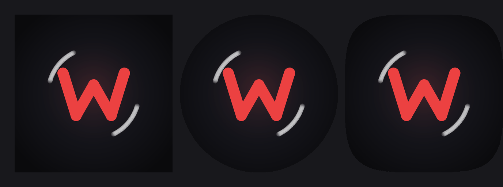

<div align="center">



# NetMusicLite

**一个为 Wear OS 手表打造的网易云音乐客户端 — 把歌单戴在手腕上**

[](https://github.com/windzhou999/WMusic-Release/releases/latest)
[](https://www.android.com/wear/)
[](https://github.com/windzhou999/WMusic-Release/releases/latest)

</div>

---

## 特性

- **手表端网易云播放** — 抬腕即听，无需掏出手机
- **封面取色 + 轻玻璃质感 UI** — 跟随专辑封面动态取色的表盘级界面
- **手势操作** — 触点缩放、主页右滑退出、原路返回
- **听歌识曲** — 集成网易 AFP 音频指纹引擎
- **发音按钮适配** — 歌词注音更友好
- **流畅度优化** — AOT 编译 + Baseline Profile，手表上也能丝滑

## 下载安装

> 最新版本请前往 [**Releases**](https://github.com/windzhou999/WMusic-Release/releases/latest) 页面下载 APK。

**方式一：adb 安装（推荐）**

```bash
adb install -r netmusiclite-1.37.apk
```

**方式二：手表本地安装**

将 APK 传入手表存储，用文件管理器打开安装（需允许"安装未知应用"）。

## 应用内更新通道

本仓库根目录的 `update.json` 是 NetMusicLite 的版本清单（事实来源）。自 v1.0.5 起，应用内入口 **设置 → 关于应用 → 检查更新** 会拉取该清单，对比 `versionCode` 后弹窗提示，下载完成并校验 SHA-256 后自动拉起系统安装器。

清单地址：

- **主源**：`https://raw.githubusercontent.com/windzhou999/WMusic-Release/main/update.json`
- **CDN 镜像**：`https://cdn.jsdelivr.net/gh/windzhou999/WMusic-Release@main/update.json`

## 更新日志

| 版本 | 更新内容 |
|------|----------|
| **v1.37** | 修复华强北等 Android 9 手表上「界面快速变化」导致的闪退：页面切得快、连续右滑返回、连点进入新页面时，上一页的界面节点已被销毁而系统的绘制/无障碍访问还在访问它，会直接崩主线程。现在所有前进与返回导航统一加了节流（Android 9 及以下约 480ms，其余约 360ms），同一段转场里连点/连滑只生效一次；节流拦下时右滑跟手动画会回弹，不会缩到一半停住。音量浮层、进度浮层、播放页更新胶囊、歌词页封面浮层等高频显隐改为「稳定显隐」——快速开关时合并翻转、满 260/320ms 才切换，减少整层界面节点的反复插入与移除。冷启动补栈、登录清栈、漫游页自动进播放页等必须成功的导航单独放行。并按真机崩溃报告确证真凶是 iPod 选歌页（CoverFlow）卡面下方的倒影：低版本的图形图层是一个真实子视图，离开该页时系统仍会重放旧页的绘制、而节点已被摘除，于是抛异常崩溃；Android 9 及以下不再创建这个图层（卡片高度、留白与点击区域完全不变，只是不显示倒影），Android 10 及以上倒影照旧。除崩溃修复外无功能变化 |
| **v1.35** | 修复小米/HyperOS 等非 Wear OS 5 手表上 m3e 主题一进列表页（搜索、评论等）就闪退：组件按系统标记误判设备带有 Wear 输入库并去加载它，这类 ROM 没有该库会直接崩主线程，现已显式关掉组件内部的表冠触感、改走应用自己的触感；修复 Android 9 及以下机型页面转场崩溃（转场创建的图形图层在部分老 ROM 上读到空子视图触发空指针，低版本改用不建图层的黑场淡入，返回时不再多罩一层黑）；新增「M3E 启动守护」——上次崩溃若发生在 m3e 主题，本次启动自动回退经典主题一次，跳出「打开就闪退、重开还是闪退」的死循环；新增设置 → 关于应用「导出崩溃日志」，把所有报告一键写入系统「下载」文件夹并提示导出份数，手表不连电脑也能取到日志；修复播放中进歌词页不能直接定位到当前句（回退上一版「秒定位」实现，改回硬定位加居中修正）；特别鸣谢新增 5 位 |
| **v1.34** | 一起听（双人房）全面修通：双方切歌、暂停与拖动进度不再互相拽回，连按播放/暂停也不会错位；手表按上一首/下一首时官方手机端会真正跟着切歌（此前只弹提示不切歌）；房内聊天现在能收到对方消息；房客点歌有确认闭环，加歌不再静默失败；双人房内全员可切歌点歌（乐迷团房仍限房主）；点官方 App 发来的邀请卡可直接进房，过期房间由服务端自动重建。新增：歌单详情页与专辑详情页的列表内搜索，输入中文译名也能命中库里存着外文原名的歌。修复：m3e 私信消息互相堆叠、文本气泡四周空白过大；「收藏的专辑」按钮末字被裁切。优化：经典主题歌单按钮放大、听歌排行按钮缩小；私信支持长按复制全文或拖选局部，私信里的一起听链接自动识别成邀请卡。另：OPPO 手表手势控制不再依赖系统私有类，改为本地传感器识别（双击捏合触发上一首/下一首/暂停继续，单击不动作），且只在开关打开、应用在前台时采集，退后台或息屏立即停止；设置中的实验性开关默认关闭 |
| **v1.3.3** | 本版无功能更新。修复小米手表上一进列表页（设置、播放队列、评论、我喜欢、更多、使用向导等）就闪退的问题：界面组件在初始化时引用了小米系统里没有的 Wear OS 私有触感反馈类，导致加载失败直接崩溃，现已补齐兼容处理；谷歌、三星、OPPO 等其他机型的显示与手感不变 |
| **v1.32** | 新增 Material 主题（使用向导首页可选「默认 / Material」：播放页扇贝播放键与弧形进度、主题色跟随封面取色、按钮亮度随背景自适应）；歌词页逐行扫光重做——光带只归属当前句、折行长句按显示行逐行推进，没有逐字数据的歌词按字数均分进度，浅色页面下聚焦行亮度自动压暗，设置可关闭扫光（关闭即完全退回原有观感）；玻璃材质统一，卡片以身后真实底图为基准取样，深色主题无壁纸也能用高斯模糊玻璃，并修掉三星表歌词整屏发糊的问题；长按主页卡片可随机抽歌（CoverFlow 选歌）；修复只导入本地音乐时列表滑动闪退、暂停后放着放着突然自己响、表冠滚动时滑动进度条自动隐藏；进一步省电（旋转封面与播放进度改定时驱动、熄屏降频、房间页轮询改状态订阅），新增「关闭表冠调音量」开关；安装权限被拒后不再反复弹窗 |
| **v1.24** | 修复应用内「检查更新」有时收不到新版本的问题：更新清单不再只取第一个成功的源，而是同时读取 jsDelivr、api.github.com 与 raw 三个源并取版本号较大者——jsDelivr 的分支缓存会在新版发布后一段时间里继续返回旧版清单，旧逻辑拿到旧清单就不再回落兜底源，设备于是显示「已是最新」 |
| **v1.23** | 新增「歌词页屏幕常亮」开关（设置页主题下方）：打开后停留在歌词页时屏幕不自动熄灭，离开歌词页立即恢复系统息屏节奏，默认关闭；修复本地导入歌词的聚焦行不落在屏幕水平中线的问题；更换应用内更新的首选下载镜像，修复更新包下载失败的问题 |
| **v1.22** | 新增收藏歌单、收藏专辑（歌单/专辑详情页头部一键收藏）与从歌单移除歌曲（自己创建的歌单多选）；歌单添加歌曲补齐官方兼容口径（512/521）；发评论、一起听建房等写操作对齐官方 9.5.90 风控口径并精简请求；设备号去品牌化改标准 UUID |
| **v1.2.1** | 新增方形屏幕适配：所有进度条拉直为直线样式，播放页底边栏改为直胶囊、距屏幕底边 20 像素；播放页标题、艺人与播放三大按钮整体下移，上一首/下一首按钮与屏幕水平中线对齐；圆形屏幕显示不受影响 |
| **v1.2** | 表冠转动曲线全面优化（转动/停转/惯性滑行无缝衔接，消除断层感）；新增 OPPO 手表传感器手势支持（捏一捏等手势直接控制播放）；新装默认外观主题改为封面模糊；修复收藏/新建歌单失败、断网或重启后红心与歌单列表丢失、封面模糊主题歌词取色偏白、音量浮层右滑穿透（小米手表）；耗电优化与离线缓存增强 |
| **v1.17** | 新增播放页「封面模糊明暗对调」开关（深色外观下可选用浅色封面模糊、浅色下可选用深色，反向调节播放页与歌词页明暗）；设置新增「特别鸣谢」栏目（免责声明上方入口，鸣谢名单每次进入顺序随机） |
| **v1.15** | 新增「封面模糊」外观模式（全站明暗随封面自动切换）；播放页面风格三选一（取色 / 封面模糊 / 自定义壁纸）与「保留取色」开关；播放页与歌词页共用同一张模糊封面底，歌词支持逐字动画；新增长按进度条、访客模式、本地音乐歌词；更新包改存系统「下载」文件夹；修复封面模糊主题进入应用时底图突然闪出、选择自定义图片后玻璃卡片失效与卡片/取色错跟壁纸，以及头图黑边、专辑 Tab 记忆、歌曲数、切评论转场黑屏、切歌残留等问题 |
| **v1.13** | 新增表冠适配开关（列表页/音量页可分别正反调节表冠方向）；修复带翻译歌词「重影」；修复更新后本地音乐失效、导入更稳；修复应用内音量界面计时问题；修复本地歌曲歌词页两层错位 |
| **v1.12** | 修复搜索框 bug（输入首字符不再跳出输入、键盘与焦点保持）；本地音乐新增歌词支持（同名 .lrc / 音频内嵌歌词 / 在线匹配兜底，歌词页标注来源） |
| **v1.1** | 华为表冠适配修正（转表冠无响应、步进与方向校准）；扩展适配非 ColorOS 手表（应用内音量面板、系统返回接管、表冠触感）；向导第一页新增方表/圆表选择；新增「关于高级版」公告页 |
| **v1.0.9** | 新版使用向导（手势图册 + 点歌名进百科/点艺人进主页演示 + 捐赠页）；设置新增字体大小/粗细调节；修复私人电台偶发重复播放、专辑与「我喜欢」页封面背景渐变断裂；默认浅色主题、种子色降饱和 |
| **v1.0.8** | 下载完成自动拉起安装器；启动静默检测新版本（播放页顶部提示胶囊）；未授权时自动引导开启安装权限 |
| **v1.0.6** | 首次登录使用向导；登录二维码加大 20%；修复向导页按钮裁切；应用改名 netmusiclite |
| **v1.0.5** | 关于应用页新增「检查更新」；接入 GitHub 远程更新通道 |
| **v1.0.4** | 更多残留修复；发音按钮适配 |
| **v1.0.3** | 触点缩放；主页右滑退出；原路返回 |
| **v1.0.2** | 关于应用页 + 封面取色；去系统壁纸取色；轻玻璃风格 + 启动图标 + 改名 |

## 反馈

使用中遇到问题或想要新功能，欢迎到 [Issues](https://github.com/windzhou999/WMusic-Release/issues) 提交。

## 免责声明

- 本项目为**非官方**第三方客户端，仅供个人学习与交流使用，请于下载后 24 小时内自行斟酌保留
- 应用内音乐内容及相关版权归网易云音乐及内容权利方所有
- 本仓库仅发布构建产物（APK）与版本清单，**不含源码**
- 如有侵权，请联系删除

---

<div align="center">

**NetMusicLite** · Made with ❤️ for your wrist

</div>
